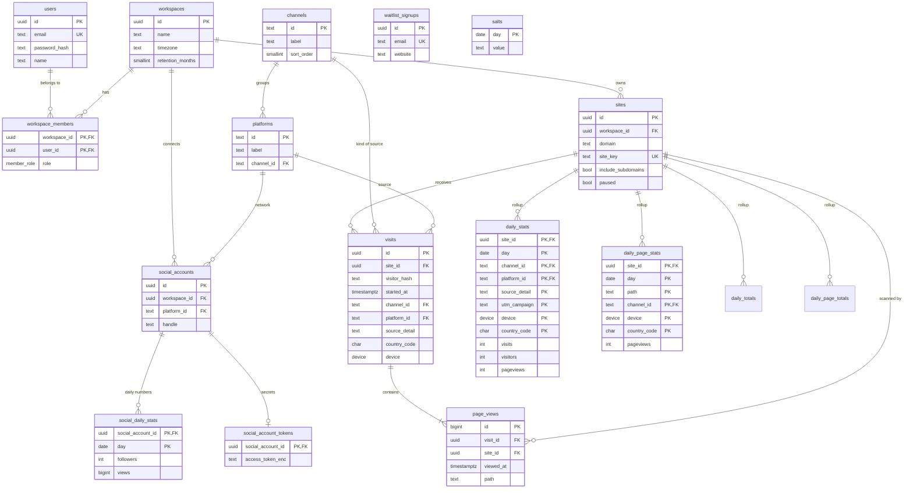

# Database guide

The database is **Supabase Postgres**, defined by three files, run in order:

1. [`20261013000000_initial_schema.sql`](../supabase/migrations/20261013000000_initial_schema.sql): tables, lookups, rules and security.
2. [`20261014000000_tracking_and_stats.sql`](../supabase/migrations/20261014000000_tracking_and_stats.sql): the functions that record visits and compute the stats (see "Functions" below).
3. [`20261015000000_waitlist.sql`](../supabase/migrations/20261015000000_waitlist.sql): the `waitlist_signups` table behind the public `/waitlist` page.

Every table and column also has a description, which Supabase shows in the **Table Editor**: hover a column name, or open a table's definition.

## The picture



## The tables in plain words

| Group    | Table                   | One row is…                                                                          |
| -------- | ----------------------- | ------------------------------------------------------------------------------------ |
| Accounts | `users`                 | a person who logs in to the dashboard                                                |
|          | `workspaces`            | a customer account (usually one company), with its timezone                          |
|          | `workspace_members`     | "this person belongs to this workspace, as owner or member"                          |
| Websites | `sites`                 | a tracked website and its settings; `site_key` goes in the tracking code             |
| Tracking | `visits`                | one visit: pages seen with no gap over 30 minutes, and where it came from            |
|          | `page_views`            | one page seen during a visit                                                         |
|          | `salts`                 | the random value used for one day's visitor hashes (deleted after 2 days)            |
| Rollups  | `daily_totals`          | visits, visitors and page views for one site, day, channel and device                |
|          | `daily_stats`           | the same, split further by platform, campaign and country (see below)                |
|          | `daily_page_totals`     | page views of one page on one site and day                                           |
|          | `daily_page_stats`      | page views of one page, on one site and day, for one channel/device/country          |
| Lookups  | `channels`              | a kind of source: Social media, Search, Email, AI assistants, Direct, Other websites |
|          | `platforms`             | a known source (Instagram, Google, ChatGPT, …) and its channel                       |
| Social   | `social_accounts`       | a connected Instagram/Facebook/… profile                                             |
|          | `social_account_tokens` | that account's encrypted login tokens, kept apart                                    |
|          | `social_daily_stats`    | that account's followers and views for one day                                       |
| Waitlist | `waitlist_signups`      | someone who asked to join on `/waitlist`: email and, optionally, their website       |

## Design rules

1. **Third normal form.** Each fact lives in one place.
   - A page view stores only _which visit_, _when_ and _which page_.
   - Its source, device and country belong to the visit and are read with a join (example below).
   - Platform names and their channel live in `platforms`, not repeated on every visit.
2. **Lookup tables instead of loose text.**
   - `visits.platform_id` must be a row in `platforms`, so a typo can't create a new "platform".
   - Websites that aren't in the list (e.g. `news.ycombinator.com`) are stored as platform `other`, with the host in `visits.source_detail`.
3. **A visit keeps its own `channel_id`,** even though platforms have a channel. A campaign link can override it, e.g. `utm_source=newsletter&utm_medium=email` is Email. So the channel is a fact about the visit, not only about the platform.
4. **One deliberate shortcut: `page_views.site_id`.** It could be read from the visit, but every stats query scans "one site, one time range". The `(site_id, viewed_at)` index makes that scan direct.
5. **Rules the database enforces:**
   - Foreign keys and unique keys.
   - Format checks: site keys `ws_XXXXXX`, bare domains, `ISO-2` country codes, paths starting with `/`.
   - Cascades: removing a website removes its visits and page views.
   - `updated_at` maintained by a trigger.
6. **Privacy by design.**
   - No IP addresses, no full user agents, no cookies.
   - The visitor hash changes every day, and the salt behind it is deleted after 2 days.
7. **Security.**
   - Row level security is on for every table, with no policies.
   - Supabase's public `anon` / `authenticated` roles have no grants at all.
   - Only the API, with the secret service key, can read or write. It scopes every query to the signed-in user's workspace.

## Reading the data

Where did yesterday's page views on a site come from?

```sql
select c.label as channel,
       coalesce(v.source_detail, p.label) as platform,
       count(*) as page_views
from page_views pv
join visits v    on v.id = pv.visit_id
join platforms p on p.id = v.platform_id
join channels c  on c.id = v.channel_id
where pv.site_id = '<site id>'
  and pv.viewed_at >= date_trunc('day', now() at time zone 'Asia/Karachi') at time zone 'Asia/Karachi' - interval '1 day'
  and pv.viewed_at <  date_trunc('day', now() at time zone 'Asia/Karachi') at time zone 'Asia/Karachi'
group by 1, 2
order by 3 desc;
```

Visits per week in the workspace timezone (Postgres weeks start on Monday):

```sql
select date_trunc('week', started_at at time zone 'Asia/Karachi') as week, count(*) as visits
from visits
where site_id = '<site id>'
group by 1
order by 1;
```

## Functions

The API calls these with supabase-js `rpc()`. Each is one database round trip, which matters on serverless. Only the service role can execute them.

| Function                                 | What it does                                                                                                                                                                                                                                                                                       |
| ---------------------------------------- | -------------------------------------------------------------------------------------------------------------------------------------------------------------------------------------------------------------------------------------------------------------------------------------------------- |
| `record_page_view(...)`                  | One tracker hit. Under a per-visitor lock, it extends the visitor's visit if they were active in the last 30 minutes, otherwise starts a new visit with the given source. It adds the page view, updates the four rollups and updates the site's first/last event (at most once a minute). Atomic. |
| `get_or_create_salt(day, candidate)`     | Returns the day's salt; the first caller's candidate wins.                                                                                                                                                                                                                                         |
| `cleanup_salts(before)`                  | Deletes old salts (daily cron).                                                                                                                                                                                                                                                                    |
| `rebuild_daily_stats(site_ids)`          | Recreates the four rollups from the raw tables. Run after a bulk import (the seed scripts do) and when a workspace changes its timezone (the API does).                                                                                                                                            |
| `stats_kpis(...)`                        | Visits, visitors and page views between two days.                                                                                                                                                                                                                                                  |
| `stats_series(..., unit)`                | Visits per bucket (day, week starting Monday, month, year) and channel.                                                                                                                                                                                                                            |
| `stats_breakdown(dimension, limit, ...)` | Top platforms, pages, campaigns, countries or devices.                                                                                                                                                                                                                                             |
| `stats_site_daily(...)`                  | Visits per site per day (site cards and sparklines).                                                                                                                                                                                                                                               |
| `stats_live(...)`                        | Distinct visitors in the last 5 minutes (reads `visits`).                                                                                                                                                                                                                                          |
| `purge_expired_data()`                   | Deletes visits, page views and rollup rows older than each workspace's `retention_months` (weekly cron).                                                                                                                                                                                           |

`stats_kpis`, `stats_series`, `stats_breakdown` and `stats_site_daily` read the rollups. They take site ids (already checked against the workspace by the API), a range of local days (inclusive), channels, device and country.

## Rollups (Phase 6)

The dashboard never scans raw visits or page views (except "on the site right now"). It reads summary tables that `record_page_view` updates with every hit. Each query reads the smallest one that can answer it:

| Table               | One row per                                                                         | Read by                                                              |
| ------------------- | ----------------------------------------------------------------------------------- | -------------------------------------------------------------------- |
| `daily_totals`      | site, day, channel, device                                                          | KPIs, chart, device list and site cards (no country filter)          |
| `daily_stats`       | site, day and _kind of visit_: channel, platform, source, campaign, device, country | anything with a country filter; country, platform and campaign lists |
| `daily_page_totals` | site, day, page                                                                     | the Pages list without filters                                       |
| `daily_page_stats`  | site, day, page, and the visit's channel, device and country                        | the Pages list with filters                                          |

The `*_totals` tables are the detailed tables summed up, kept separately because most views have no country filter.

How the numbers are defined:

- **Days** are calendar days in the workspace timezone. Changing the timezone rebuilds the rollups.
- **Visitors:** the visitor hash changes every day, so a visitor is counted once per day. They are counted in the kind of visit of their first visit that day. With a filter, visitors means people whose first visit of the day matches it.
- **Page views** count on the day they happen, under the visit they belong to.

These tables are derived data, not a second source of truth: `rebuild_daily_stats` recreates them exactly from `visits` and `page_views`, and a test checks that. On 1M page views (`npm run bench`) every dashboard query answers in under 500 ms, even on the in-memory test database.

**Retention:** the weekly cron deletes raw visits, page views and rollup rows older than `workspaces.retention_months`. The BRIN index on `page_views.viewed_at` makes those deletes cheap. Monthly partitions are the next step if deletes ever get slow.

## Changing the schema

1. Add a **new** file in `supabase/migrations/` (e.g. `20261101000000_add_x.sql`). Never edit a migration that has run against data.
2. Add a description for each new table and column (`comment on …`) and keep RLS on.
3. Update `apps/api/src/db/database.types.ts`: run `npm run db:types`, or edit it by hand.
4. Update this page.

> The current migration replaced an earlier draft while the database was still empty. To bring a database built from the draft up to date, run [`supabase/scripts/reset_public_schema.sql`](../supabase/scripts/reset_public_schema.sql) first. It deletes all app tables.
